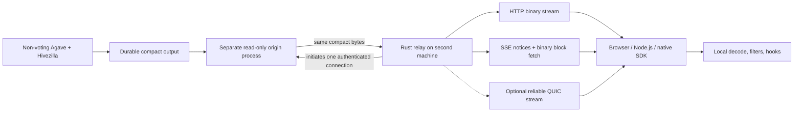

# Compact block stream and Rust relay

Updated: 2026-10-10, Europe/Paris.

## Current target: compact once, stream at processed

On 10 October the owner selected a single processed block feed. This replaces
the finalized-first plan below. Build one immutable compact payload as soon as
the bank is fully executed and all required callbacks are present. Do not wait
for a root. Relay the same bytes to every client. A finalized callback must not
cause a second full block message, another replay, or another compaction.

Finality remains an internal archive decision: select the winning bank, add a
catalog reference to its existing payload, attach any later finality evidence
separately, and apply retention. Upload and query index construction still need
work. No epoch-wide dictionary rewrite belongs in the live delivery path.

Capture keys are `(source session, slot, bank_id)`; bank IDs are node-local.
Parent links and block hashes identify complete candidates. Competing banks at
one slot must remain separate. Use a durable event sequence for resume rather
than a strictly increasing slot. Small invalidation records let clients undo
effects from a removed bank. Finality control records, if supplied, are not a
second block payload. Transport retries remain at-least-once and may repeat an
existing payload. A client must not treat receipt as finality.

The processed profile is now implemented. The worker uses bank completeness
checks before root, the same Compact V2 codec, and an atomic event log. The
origin, relay, Rust decoder, and JavaScript SDK accept one-bank payloads and
payload-free controls. The public endpoint changed to this feed on 10 October.
R2 stores its frames in a separate processed namespace. Local source retirement
requires rooted custody evidence that binds the existing payload. Local compact
file retirement after R2 upload and archive query integration remain unfinished.
These are bounded integration checks, not an uninterrupted epoch or capacity test.

[Solana's Alpenglow guide](https://solana.com/upgrades/alpenglow) says that
confirmed and finalized converge, while processed notifications remain. It also
requires separation of banks at one slot and handling UpdateParent invalidations.
Alpenglow compatibility must detect the active consensus and use block metadata
and footer rules for completeness rather than assuming a final PoH tick.

## Historical implementation: finalized pilot

Historical update on 5 October: the source reader and relay were repaired after a
SQLite read-only failure. The feed was LIVE on the Foundation machine. A separate
Rust publisher now saves native stream frames and an ordered catalog to
Foundation R2, from the start of epoch 1050. It is catching up to live output.
Public R2 reads, R2 SDK recovery, and the separate Hetzner relay remain
unfinished. See the current [deployment record](../../hivezilla/deploy/direct-agave/README.md#stream-repair-and-live-r2-publication-2026-10-05).
Status: a Rust origin and relay run on the Foundation machine. Cloudflare Tunnel
serves the relay at `https://stream.blockzilla.dev`, with a consumer API key.
Public SSE notices and finite binary GET requests passed a bounded Rust client
test. Direct binary streaming remains available locally; the public tunnel can
buffer a long binary response. Binary HTTP, SSE notices, finite chunks, and a
browser/Node raw transport helper are implemented and tested. The first full-feed
SDK also runs a shared
Rust/Wasm semantic decoder in browsers and Node.js, with local program/account
filters and chunk checkpoints. A second-machine deployment, full RPC rendering,
and supported public projection contract remain unfinished.
See `hivezilla/stream-relay/README.md` and its evidence directory.

The owner has selected stream work as the current priority. The installed pilot
uses finalized blocks. It must be easy to consume from browsers and Node.js.

The owner confirmed a simple full-feed SDK first on 2026-10-04. The optimized
index feed with selective GET requests remains a separate later source for the
same SDK interface. The full-feed source transfers every compact block before
local filtering; small returned records reduce JSON expansion, not wire traffic.
The current SSE endpoint remains chunk discovery followed by full binary GETs.
Inline blockhash/signature receipt events are a separate proposed surface.

The first semantic SDK passed ten Rust and fourteen JavaScript tests. Node and
real Chrome received four identical live blocks through binary HTTP and SSE.
An independent local finalized RPC comparison checked all 4,461 transactions,
338 program matches, 914 account matches, and 658 failed execution results.
The replay checkpoint test and repeated Wasm-buffer ownership test passed.
These are finite pilot checks, not a full epoch or public capacity test.
See `hivezilla/stream-relay/evidence/sdk-live-20261004.json` and
`sdk-rpc-oracle-20261004.json`.

## Machine roles and connection direction

The 5 October live check found all six services active on
`ubuntu@213.239.141.61`. The relay reported `LIVE`, with an intake age of
261 ms. The origin and relay still listen on loopback addresses.

| Service | Current machine | Planned machine |
| --- | --- | --- |
| Non-voting validator | Foundation | Foundation |
| Hivezilla compact worker | Foundation | Foundation |
| Read-only compact origin | Foundation | Foundation |
| R2 uploader | Foundation | Foundation |
| Rust relay | Foundation | Second machine |
| Consumer-facing Cloudflare Tunnel | Foundation | Second machine |

R2 storage is on Cloudflare. The table lists the uploader process, which reads
the local compact output.

The second machine's SSH address is still needed. Prepare it while the current
relay continues to serve clients:

1. Give the second relay a secure path to the Foundation origin. Use TLS with
   client certificates and an origin API key. Check the server certificate name.
   Limit origin access to the relay machine. The current `127.0.0.1:8870`
   address cannot be used from another machine.
2. Start the same tested Rust relay release, with its own replay store and
   Cloudflare Tunnel. The relay opens the upstream connection; clients do not
   connect to the validator.
3. Test live progress, binary chunk integrity, authentication, and cursor resume.
   Let its replay window overlap the active relay before switching clients.
4. Route `stream.blockzilla.dev` to the second relay. Keep the current relay
   available until public Rust clients pass the same checks. Preserve the
   consumer API key and public URL. Do not restart the validator or compact worker.

This is the intended deployment after the move:

The relay initiates the upstream connection. The origin serves one bounded,
ordered binary feed over a long-lived HTTPS connection. Start with HTTP/2 and
TLS so the same framing works for both replication and public HTTP clients.
Compare reliable QUIC against this baseline later. Use the measured result to
select the native transport. Do not assume that QUIC is faster.

Keep the origin outside validator callback threads. It reads only committed
compact output, after the worker cursor advances. Give it a read-only view,
limited CPU/RAM, and a finite read rate. It must not write to the capture journal,
change retention, or make validator progress depend on a relay ACK.

The second machine absorbs client connections, authentication, fan-out, and
short-term replay. One upstream connection supplies all of its consumers.
The relay passes compact bytes without transaction decode or client-specific
filters. The client framework performs those tasks.

## Measured network use

At 21:45–21:46 UTC on 5 October 2026, a 55-second read-only sample measured
130.438 Mbit/s received and 164.578 Mbit/s sent on the Foundation machine's
external bond. These are whole-machine rates, including validator and other
traffic. No interface error or drop counters increased. The relay received
99,855,145 compact frame bytes, averaging 14.520 Mbit/s, with a highest
five-second average of 17.883 Mbit/s. This includes frame data and dependencies;
it excludes HTTP, TLS, and network headers. The relay remained LIVE.

For a first bandwidth estimate, budget 20 Mbit/s per full-feed client and keep
30 percent of the uplink free for bursts and recovery. A dedicated relay with
1 Gbit/s of usable internet bandwidth can then budget about 35 clients;
10 Gbit/s, about 350 clients; 100 Gbit/s, about 3,500 clients. These are bandwidth
estimates. CPU, HTTP request capacity, tunnel behavior, and real external load
remain to be measured. On Foundation, its existing outgoing traffic must also
be deducted from the budget.

The bond reports two active 100 Gbit/s physical links. This does not establish
the available internet uplink. The current relay has a limit of 32 active HTTP
requests and 64 TCP connections. Each SSE subscription holds one request permit;
binary GETs require additional permits. Ten simultaneous clients passed an
earlier local test. The large bandwidth estimates are not tested client limits.
See [the sample receipt](../../hivezilla/stream-relay/evidence/network-capacity-20261005.json).

The following measurements are older samples:

Read-only samples on 4 October 2026, around 09:49 Europe/Paris:

| Scope | Receive | Send |
| --- | ---: | ---: |
| Validator process socket payload, about 20.6 seconds | 146.0 Mbit/s | 128.3 Mbit/s |
| Machine external bond, 30 seconds | 148.5 Mbit/s | 161.0 Mbit/s |
| Machine external bond, 3 October average | 131.4 Mbit/s | 141.9 Mbit/s |

These samples use different time windows. Socket payload counters exclude network
headers and some interface traffic. Count bond0 once; adding its slave counters
would count the same traffic twice. No interface drops or errors increased during
the short sample. Non-voting still has substantial outgoing traffic.

Yesterday's average rate is about 1.42 TB received and 1.53 TB sent per day,
in decimal units. This is a projection from the recorded average, not a billing
record. Initial sync and file transfers can change traffic substantially.

A recent 299-second compact-output sample contains 1,116 blocks and 1,343,808
transactions. Existing block frames alone amount to 5.8 Mbit/s. The current
projection object set, including keys, signatures, available PoH, and reader
indexes, amounts to about 13.2 Mbit/s, or 442 KB per block. This excludes
source-events.json.zst and the normalization receipt. The complete evidence bundle
is about 52.6 Mbit/s.

The projection rate is a file-size estimate, not a deployed wire measurement.
The SDK's required file set and execution-metadata coverage must be established
before reducing that set. Do not use the 5.8 Mbit/s frame-only number as a complete
client feed. Small current batches repeat registries; measure registry and
signature compression separately before changing the format.

At the sampled projection rate, 100 full-feed consumers require roughly
1.32 Gbit/s of relay output before transport overhead and recovery traffic.
One relay still adds only one feed to the origin. The relay moves the fan-out
cost; it does not remove unicast bandwidth cost. Size and limit subscriptions
from measured peak traffic and the second machine's actual uplink.

Evidence:
[network and compact sizing](../benchmarks/artifacts/hivezilla-network-and-stream-sizing-20261004.json).

## Required HTTP and SSE surfaces

These routes work in the loopback pilot. They are not public endpoints yet.

| Route | Content | Consumer |
| --- | --- | --- |
| GET /v1/blocks?after=CURSOR | Open HTTP response with framed compact binary data | Browser fetch, Node.js fetch, Rust |
| GET /v1/events?after=CURSOR | SSE block/chunk notices with stable IDs and binary URLs | Web apps and notification consumers |
| GET /v1/chunks/CONTENT_ID | Finite immutable binary chunk, including required decode dependencies | Browser/Node.js fetch and short replay |
| GET /v1/head | Stream identity, latest committed position, earliest retained position, source state | Discovery and recovery |

Binary HTTP is a first-release requirement. Clients must be able to receive all
block bytes over one connection without SSE, JSON conversion, or base64. Use
versioned content framing inside the response. A network read can contain part
of a frame or several frames; the SDK must handle both cases.

SSE is also a first-release requirement. SSE sends UTF-8 event data, so its normal
mode sends a small descriptor and a binary URL. It does not embed a large base64
block. Event IDs support reconnect discovery; a received notice is not a durable
application ACK. If an inline SSE block mode is later requested, expose it
explicitly and measure its approximately one-third base64 size increase.

SSE and binary clients refer to the same block identities and content digests.
One immutable chunk may contain one or a few blocks and its registry dependencies.
Do not delay live delivery until a 32-block batch is full. Retain the existing
compact block format inside a transport envelope. Envelope framing must not
create a second transaction or metadata schema.

Public stream responses bypass caches and disable proxy buffering. Finite chunks
can use shared caches with authentication before access. Provide explicit CORS
rules, abort/cancel support, heartbeat or idle detection, and no response-wide
compression buffer that delays a block. Native EventSource does not accept an
arbitrary Authorization header; use an authenticated cookie or the SDK's
fetch-based SSE reader. Never put a permanent API key in a URL.

## Origin access and safety

Use mutual TLS for the machine-to-machine link. The origin accepts only approved
relay certificates; the relay checks the origin certificate and name. Limit the
origin port to the relay's address or a private network where available.
Certificates and keys are separate from the validator identity.

Authenticate once per connection. Keep the connection open. TLS still encrypts
and authenticates transmitted records; measure its CPU cost rather than promising
zero overhead. Do not add a signature operation to every block on the live path.
Reuse the compact builder's content digests and check them incrementally while
receiving a chunk. This is distinct from expensive Solana signature verification.

Use finite connection counts, handshake deadlines, frame and object size bounds,
read/write deadlines, and a byte-based backlog. Disable early-data acceptance
initially. Key revocation must close affected existing connections too.

The relay has a shared byte ring and a bounded local replay store. Subscribers
hold positions and references to immutable buffers, not private copies of the
whole feed. Account for buffers held by slow subscribers as well as the ring.
A slow client is disconnected when it exceeds a configured byte or time limit.
It cannot block relay intake or validator capture. Encryption and socket writes
still cost work for each consumer; shared buffers are not a claim of zero-copy
network delivery.

An upstream outage must leave a visible stale head. Reconnect with bounded
backoff and resume from the relay's durable position. Transport ACKs are not
durable storage ACKs. The origin must not retire replay data merely because it
was sent or because one relay acknowledged it.

## Data identity and recovery

The envelope binds the cluster/genesis, format and projection version, operator
source identity, capture session, finalized commitment, stable event identity,
slot/blockhash, parent identity, object lengths, content digests, and exact decode
dependencies.

The current native output is an operator-trusted rooted execution projection.
Its markers say canonical=false and publication_ready=false. A development
stream must preserve that provenance. It must not present these files as a
Blockzilla canonical archive or forge an older execution-canary publication
marker. Admission to a supported public profile needs an explicit contract and
field-coverage review.

The origin adapter discovers output from committed.sqlite and the durable
CURSOR.json, not from a directory's newest name. A compact directory visible
before the worker cursor commits is not yet eligible. Session changes retain
old cursor identity and explicitly report capture gaps.

Use at-least-once delivery. A complete chunk is admitted only after required
files, bounds, dependencies, and digests match. Applications advance their own
checkpoint only after processing is durable. Reconnect may resend an event;
identical identity/digest is safe to deduplicate. Changed content for an admitted
identity or conflicting finalized blockhash stops the feed.

A slot jump is not automatically missing data because Solana can skip slots.
Use parent links and source coverage evidence. If a requested position is outside
retention, return explicit replay-unavailable information with the earliest
available position. Do not silently start at the current head. Until archive/R2
backfill is connected, report that limit honestly.

## JavaScript SDK

Provide one small package for browsers and supported Node.js versions. Its
transport layer uses fetch and ReadableStream, without requiring WebSockets
or a native QUIC dependency. Its API must expose an async iterator, cancellation,
reconnect, an explicit checkpoint, and clear gap/source-stale errors.

Support binary HTTP by default and SSE-plus-binary as an alternative. Hide frame
fragmentation, dependency ordering, bounded fetching, and deduplication from the
application. Expose raw compact bytes as well as typed decoded blocks.

Build the decoder from the shared Rust compact implementation, with a portable
WASM or supported JavaScript binding. Existing Rust archive scans are not proof
that a browser decoder exists. Establish this portability with a real browser
and Node.js test. Large browser decode work belongs in a Web Worker. Filtering,
subscriptions, and hooks remain local.

## Implementation and test order

1. Freeze the public projection, envelope, cursor, size limits, and error contract.
   Review what the compact projection preserves against native transaction metadata.
2. Build the separate Rust origin adapter and Rust relay. Start with binary HTTPS,
   finite chunk fetch, SSE notices, authentication, bounded memory, and restart
   recovery. Test on a recorded range without changing validator callbacks.
3. Add the browser/Node.js transport helper and shared decoder binding. Test binary
   and SSE clients against the same recorded blocks, then against live output.
4. Connect a second machine, then measure one, ten, and one hundred consumers,
   including slow readers, disconnects, relay restarts, malformed frames, and
   missing/out-of-window cursors. Measure latency from finalized callback separately
   from Solana finality delay; track bytes, TLS CPU, RAM, queues, and origin reads.
5. Compare reliable QUIC with HTTP/2 using identical bytes and commitment on the
   same machines. Keep HTTP for browser/Node.js access whatever native transport wins.
   QUIC stream delivery includes loss recovery and congestion control. Raw UDP
   or unreliable QUIC datagrams require a separate repair protocol and are not
   the first finalized-block feed.

The relay machine's SSH address is still needed for a two-machine deployment.
No second machine was provisioned and no new public port was opened for this design.

At the 20:25 Europe/Paris check on 2026-10-04, native capture and compact output
were advancing in epoch 1049. The health report showed three slots of compact
lag and no current compact problems. The relay was LIVE and not stale. Raw shred
recording had stopped at its cumulative quota; compact output continued. Local
free space was about 1.56 TB. Full-epoch coverage remains unproved.

The token SQLite consumer is running, but its longer run needs correction before
it can be treated as a steady live client. It was BACKFILLING, about 4,880 slots
behind compact output. In a 15-second sample its checkpoint advanced 41 slots
while compact output advanced 53. Its SQLite file was about 18.9 GB. This short
sample proves continued recovery progress, not sufficient catch-up capacity.
The cause has not been measured. The earlier 292-block recovery and restart
checks remain valid finite tests; they do not establish sustained throughput.

The next reliability work is retained-byte quota accounting for raw recording,
indexer throughput and database retention, and a durable current-epoch recovery
source. The second relay machine, authenticated chunk caching,
and external load test still remain to be deployed. The public route is now live.
Stream work does not certify
native capture recovery or full epoch coverage.

## Protocol references

- [SSE text encoding, reconnect, Last-Event-ID, and EventSource constructor](https://html.spec.whatwg.org/multipage/server-sent-events.html)
- [Browser fetch response streams](https://developer.mozilla.org/en-US/docs/Web/API/Streams_API/Using_readable_streams)
- [Node.js fetch](https://nodejs.org/api/globals.html#fetch)
- [Base64 encoding](https://www.rfc-editor.org/rfc/rfc4648.html)
- [QUIC reliable streams and congestion control](https://www.rfc-editor.org/rfc/rfc9000.html)
- [QUIC TLS and peer authentication](https://www.rfc-editor.org/rfc/rfc9001.html)
- [Unreliable QUIC datagrams](https://www.rfc-editor.org/rfc/rfc9221.html)
