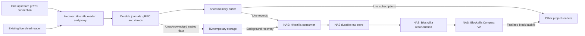

# Hivezilla live relaunch: one reader first, a hive of readers later

Review date: 2026-09-19. Code reviewed at `c05452d4`.
Status updated 2026-09-25: overflow catalog, bounded R2 transfer, and committed
gRPC journal conversion implemented. This flow is not yet implemented end to end. No deployed service or
storage policy changed.

The first release has one Hivezilla reader on Hetzner and one Hivezilla consumer
on the NAS. The reader captures one upstream gRPC connection and input from the
existing live shred reader. The consumer stores both inputs and recovers older
records from R2. Blockzilla owns reconciliation and compaction on the NAS and
produces Compact V2.

Other projects can subscribe as live readers through the same Hetzner service.
They share the upstream connection and do not run compaction or acknowledge
raw-data custody. After an outage, they recover finalized blocks from Blockzilla.

The long-term target is a hive of independent Hivezilla readers. Multiple
readers will feed the consumer, and Blockzilla will reconcile their observations
into complete, finalized blocks. The first release must preserve that ownership
and record identity, while running only one reader and one consumer.

The disk journal is required behind the memory buffer. It protects accepted
records during a process restart or power loss, subject to disk survival.
Memory is a delivery cache. A full cache must not discard the last durable copy.

The proxy can expose one gRPC service to the NAS for both inputs. Keep separate
logical streams, sequence numbers, range indexes, and ACKs for gRPC records and
raw shreds. An ACK for one input must not retire the other. Reader repair-WAL
records must also retain their distinct stream identity and repair evidence.

## Ownership and the future hive

| Component | Responsibility |
| --- | --- |
| Hivezilla reader | Capture exact observations, keep a durable source journal, serve recent records, and manage temporary R2 overflow |
| Hivezilla consumer | Receive live records and recovered ranges, store them durably, verify transport identity, and acknowledge protected prefixes |
| Live subscriber | Read shared live observations, keep its own application checkpoint, and recover finalized blocks from Blockzilla; no custody ACK or compaction |
| Blockzilla | Reconstruct and compare candidates, reconcile all sources, resolve block identity and finality, repair gaps, order blocks, and publish Compact V2 |

Hivezilla can precompute derived data from durable observations. Such data must
retain its source identity and conversion version so Blockzilla can verify or
rebuild it. Precomputation cannot select the canonical block, close a block gap,
or authorize archive publication.

Preserve these rules in the first release:

- Give each reader a stable identity. Give each input stream and generation its
  own identity, sequence, prefix digest, cursor, and R2 namespace. Reuse the
  existing protocol identities where they provide these fields.
- Configure readers as a list with one entry at first. Bind each stream to its
  permitted reader and the one configured consumer. Adding a reader must not
  change stored identities or require a new archive format.
- Keep transport deduplication separate from block reconciliation. Receiving
  the same exact record twice is a retry. Two readers observing the same block
  are distinct source records whose shared block content Blockzilla can deduplicate.
- Keep each stream's recovery and ACK independent. One reader's progress cannot
  acknowledge another reader's records. There is no global capture sequence
  across the hive.
- Blockzilla can use sufficient verified evidence from available readers; it
  need not wait for every configured reader. Preserve conflicts and provenance,
  and apply the configured trust and finality rules. Reader count alone does
  not prove a block is canonical or complete.

The initial release uses static configuration. Peer discovery, reader-to-reader
coordination, and automatic membership are later work. Multiple readers should
provide independent observations; multiple connections to one provider do not
by themselves remove that provider's failure risk.

## Shared live subscriptions and Blockzilla backfill

One Hetzner process serves the NAS custody consumer and ordinary live
subscribers. It has one upstream gRPC subscription. Add subscribers to the
local fan-out; do not open a provider connection for each project. A subscriber
can select the supported block, transaction, or shred stream. Its selection
must not narrow the upstream data required for complete NAS capture.

Reuse the public exit contract in `service/proto/public_exit_v1.proto` for
read-only subscriptions, subject to an explicit gRPC payload contract. Keep
this API separate from the NAS sync/ACK API, on the same configured service.
Give projects separate credentials and stream permissions. Subscription
credentials cannot send a custody ACK, retire data, or request compaction.
Apply per-client and total byte limits. Disconnect a slow subscriber with an
explicit recovery response; capture and NAS delivery must continue.

Subscribers keep two distinct checkpoints: the exact live stream cursor and
the last finalized block durably handled by the application. On reconnect,
replay retained live data when possible. When exact replay is unavailable,
return the missing range and the Blockzilla recovery mode. Start live delivery
at a fixed boundary while backfill runs with separate limits. The application
must not treat the new live cursor as proof that the missed blocks were read.

Blockzilla serves finalized, reconciled blocks, with block identity, parent
links, and explicit range coverage. The backfill starts with overlap at the
application's saved finalized checkpoint and stops at an agreed finalized
boundary. The application deduplicates by canonical block identity and handles
provisional live observations separately. Unresolved ranges stay pending or
unavailable. If Blockzilla or the NAS is offline, recovery waits; the service
must not report the range as complete. Live intake can continue within its
own limits.

Compact V2 backfill cannot reproduce the exact original gRPC messages or raw
shred datagrams. A client that needs exact raw replay must stay within raw
retention or use an explicit raw-storage contract. The existing public exit
schema already distinguishes `CANONICAL_LOOKUP_ONLY` from replay. Its validators
and protobuf schema do not yet implement the subscription runtime or the
Blockzilla backfill endpoint. The earlier
[public exit design](../design/hivezilla-public-exit-protocol.md) covers exact
raw replay; canonical block backfill is an additional path for this relaunch.

## Findings that block the requested flow

These findings concern the relaunch target. The current low-level commands
deliberately implement a smaller set of functions.

| Priority | Finding and effect | Code evidence |
| --- | --- | --- |
| P1 | Complete live Compact V2 publication is disabled. gRPC conversion marks shred-boundary data as missing. Live shreds can supply that evidence, but verified reconstruction and matching to gRPC are not connected to publication. Keep the check until this path exists. | `blockzilla/cli/src/archive_v2.rs:3515`; `hivezilla/service/src/grpc.rs:3919`; `hivezilla/service/src/ingest/shred_compact.rs:158` |
| P1 | Shred delivery can lose data before durable admission. The reader drops a datagram when it cannot reserve forwarding-queue space; UDP delivery also has no durable ACK. Drop counters alone cannot prove which blocks remain complete. Capture must expose loss, and NAS coverage must detect and repair missing data before publication. | `hivezilla/service/src/shred_reader/receiver.rs:787`; `hivezilla/service/src/ingest/shred_udp.rs:93` |
| P1 | Upstream replay can resume beyond a missing range. The recorder wrapper saves gap evidence, then resumes at the provider floor plus headroom. This preserves new intake, but does not repair the missing blocks. A separate coverage check must stop archive progress at the unresolved range. | `hivezilla/service/scripts/linux-raw-grpc-recorder.sh:2280`; the recovery alert explicitly leaves slots missing at line 2243 |
| P1 | The relay has only bounded memory replay. It rejects a request outside the retained window and disconnects a client that falls behind. The pull source serves one batch until its ACK arrives. Neither path currently provides live intake plus independent R2 recovery. | `hivezilla/service/src/grpc_relay.rs:527`; `hivezilla/service/src/ingest/replication_pull_source.rs:313` |
| P1 | The materializer cannot reconcile live and recovered records. It requires strictly increasing slots within one stopped raw capture. Duplicates, overlapping generations, forks, and late R2 records need a prior selection step. Increasing slots alone also do not prove complete coverage. | `hivezilla/service/src/grpc_raw.rs:4598`, especially line 4624 |
| P1 | A receiver ACK currently proves local staging durability. It does not prove an independent copy or a permanent raw-store policy. Reusing that ACK for deletion without defining the NAS durability policy can remove the last recoverable copy. | `hivezilla/service/src/ingest/receiver.rs:399`; source GC is off by default in `replication_pull_source.rs:122` |
| P2 | R2 upload exists, but the complete NAS recovery and cleanup loop does not. The native uploader writes verified immutable generations. The recorder wrapper permits only a retention dry run with a zero deletion limit. This is safe, but storage can grow without the new ACK-driven cleanup loop. | `hivezilla/object-store/src/uploader/generation.rs:270`; `hivezilla/service/scripts/linux-raw-grpc-recorder.sh:3634` |

Two source checks are also required before a canary. The current subscription
uses `Confirmed` at `grpc_raw.rs:3645`. Archive selection must wait for
finality. Also, payload format 2 rejects a transaction with the newer V1 config
field at `grpc_raw.rs:77`. Confirm source compatibility; do not remove that
check without a new stream schema and matching readers.

## Reuse the existing parts

| Part | Reuse | Work still required |
| --- | --- | --- |
| Raw capture | `grpc_raw.rs`, `ingest/spool.rs`: compressed records, checksums, durable append, rotation, restart recovery | Put the relaunch runtime around these parts; preserve the write-before-publish order |
| Shred capture and delivery | `serve-shred-reader`, `record-shred-udp`, `serve-shred-spool-pull-source`: reader output, durable raw datagrams, NAS pull | Connect shred ranges to the same recovery service and R2 policy; preserve distinct stream ACKs |
| Shred reconstruction and repair | `ingest/shred_compact.rs`, `shred_reader/repair_*`: coding-shred recovery, ordered components, conflict checks, repair WAL | Reuse shared reconstruction helpers under Blockzilla's reconciliation policy; add complete trust checks, finality, and a verified gRPC join |
| Memory delivery | `grpc_relay.rs`: bounded ring, slow-client handling, wakeups | Use a persistent record cursor for NAS delivery; the current relay sequence resets with the process |
| Live subscribers | `public_exit_v1.proto`: stream discovery, subscriptions, explicit replay-unavailable responses | Implement project authentication, shared fan-out, and Blockzilla canonical backfill; subscriber progress cannot affect custody |
| Transport | Pull runtime: mTLS, limits, reconnects, ACK persistence | Add live and recovery paths under one configured service |
| Sync contract | `hive_sync_v1.proto`, `protocol/src/sync.rs`, `v1_wire.rs` | Implement the server/client runtime; the schema and validators alone do not serve `HiveSyncV1` |
| R2 | `object-store/src/uploader/`: immutable publication, verification, commit marker, receipt recovery | Add a durable record-range index, NAS recovery, and ACK-bound retention |
| NAS preparation | `GrpcRawArchiveWriter`, pubkey runs, signatures, blockhash sidecars | Read reconciled input in a bounded background job |
| Compact V2 | Existing Blockzilla encoder and registry builders | Add the safe input adapter, coverage/finality checks, and live job execution |

The existing live materializer scheduler module explicitly has no executor or
runtime hook (`blockzilla/cli/src/scheduler/live_materialize_task_model.rs:4`).
The `LivePreHotBlock` type exists, but that does not mean the raw materializer
already produces the full pre-hot path.

`shred_compact.rs` is behind the `shred-reconstruction` feature. Its trial
returns provisional blocks and does not publish an archive. Its bounded trial
window can discard older candidates; do not use that diagnostic window as the
production coverage index.

## Small runtime design

Use one Hivezilla reader/proxy service on Hetzner, one Hivezilla consumer on the
NAS, and Blockzilla reconciliation and compaction on the NAS. Keep the existing Rust
storage and protocol code. Add read-only project subscriptions to the Hetzner
service. Keep membership static and compaction on the NAS. Move the required
recorder control loops into Rust, in line with the
[runtime boundary](rust-runtime-boundary.md).

1. **Capture and retain.** Append each accepted record to the durable source
   journal for its input. Retain raw data and coding shreds, including duplicate
   observations. Publish each record to the short memory cache after the append
   and its progress record are synced. Keep a stable stream identity, sequence, and
   prefix digest across normal restarts. Preserve legacy readers during any
   journal-format migration.
2. **Spill when the NAS falls behind.** Measure progress from the durable NAS
   ACK for each stream, not an open socket. If unacknowledged data exceeds an age
   or byte limit, seal a bounded segment and upload it. Verify the remote object and persist
   its exact range and checksum before removing the local copy. Keep the active
   partial segment on disk. An upload receipt permits local eviction only; it
   does not permit deletion of the R2 copy.
3. **Resume live and recover in parallel.** Atomically choose a cutover cursor
   `T` per stream and register its live reader at that boundary. Serve records
   from `T` onward while the NAS recovers `[C, T)`, where `C` is its acknowledged prefix.
   Use memory or disk for recent records and R2 for older segments. Give live
   delivery and recovery separate byte and work limits. A slow live reader must
   reconnect and recover; it must not cause capture loss or unbounded memory.
4. **Store, then acknowledge.** Both paths enter the same NAS durable raw store.
   Exact duplicate records are safe to receive again. A different payload for
   the same stream/sequence is an error. Track recovered ranges on disk. Advance
   the cumulative ACK only across a contiguous verified prefix. Records above
   a gap can be stored but cannot move that ACK past the gap. Persist the ACK
   and source retirement checkpoint before source cleanup.
5. **Reconcile in Blockzilla.** Read the durable source streams and recover
   missing data shreds from coding shreds where possible. Verify signatures, Merkle proofs, component
   boundaries, and PoH under the pinned source policy. Match the result to gRPC
   by slot, parent, final PoH hash, and ordered signed transactions; never join
   on slot alone. Keep consensus block IDs distinct from final PoH hashes.
   Attach execution metadata only to the exact matching transactions. Record
   finality and the disposition of each slot:
   produced and present, proven skipped by the chain, or unresolved. Keep
   competing observations until selection is complete. Validate block identity
   and parent links. A missing record is never proof of a skipped slot. A later
   slot or a sorted list cannot close a gap.
6. **Prepare and compact on the NAS.** Hivezilla may precompute from durable raw input.
   Emit verified transaction/entry data, pubkey count runs, signatures, and
   blockhash sidecars. Keep derived results tied to their source identity and
   conversion version. Assign dense block IDs and final registry IDs only after
   Blockzilla's ordered selection. Blockzilla publishes Compact V2 only after all required evidence for
   its range is present and the output checks pass.

Shreds supply ledger data: signed transactions, PoH entries, ordered block
components, and shred boundaries. They do not supply execution metadata,
rewards, block time, or block height in the current reconstruction path
(`ProvisionalShredBlock`, `shred_compact.rs:20`). Use gRPC for those fields and
finality evidence. A successful reconstruction alone does not prove finality.

For the smallest archive path, prefer finalized full-block subscription if the
provider supports it. Otherwise capture the necessary finality events in the
same upstream connection and keep confirmed blocks provisional. Verify the
actual provider behavior before changing the subscription.

Use the existing HiveSync cutover/range model where possible. If the NAS is to
download R2 objects directly, it needs read-only access plus verified object
references bound to the requested ranges. The current `FetchRange` response
carries bytes, not an R2 object reference. Add that small transport extension
explicitly; routing every old byte through Hetzner does not implement direct
NAS downloads.

## Coverage and durability rules

Hivezilla maintains per-stream progress values: the captured record tail, the
NAS stored prefix, and the protected prefix that permits source retirement.
Blockzilla tracks finalized block coverage and the published Compact V2 range.
Do not replace these with one “latest slot” value. A complete block assembled
from several readers does not acknowledge their raw streams.

Transport recovery repairs data that Hetzner captured. Upstream recovery repairs
data that Hetzner never received. R2 overflow solves only the first case. Keep
one paid gRPC source alongside the live shred reader. Use coding-shred recovery,
the reader's repair data, on-demand replay, or historical repair for the second
case. Preserve repair provenance. Keep unresolved gaps visible until verified
repair closes them. Neither healthy gRPC traffic nor healthy shred traffic
proves the other input is complete.

Use verified live shred data as the normal source of the PoH/shred-boundary
evidence absent from the gRPC path. Keep CAR repair as a fallback for remaining
gaps before complete publication. If gRPC misses execution metadata, shreds
alone cannot repair it; obtain matching metadata from another retained source
or historical repair. Ordinary RPC block data can help recover transactions
and metadata, but cannot replace missing PoH entries or shred geometry.

The remaining durability choice is whether the relaunch must survive complete
loss of a host or disk, as well as restarts and network outages. A synced NAS
copy alone does not cover NAS loss. A short local journal alone does not cover
Hetzner disk loss before replication. Full host-loss protection requires an
independent recoverable copy and a defined protected-ACK boundary. Uploading
only when the NAS is offline cannot provide zero-loss protection for every
newly received record. Keep deletion disabled until this policy is explicit.
Compact output is not an exact-raw backup.

## Cost controls

Use one upstream gRPC subscription, the existing shred reader, bounded memory,
compressed segment uploads, and NAS compute. Upload data that still needs protection; batch records into files
instead of one object per block. Use a durable range index instead of repeated
full bucket listings. Delete temporary objects only after the required ACK.

R2 charges for storage and operations; direct R2 egress is free. This supports
direct NAS recovery, but does not make long retention or many small objects
free. See [R2 pricing](https://developers.cloudflare.com/r2/pricing/).

Set limits from measurements for both inputs: memory bytes from input rate and
replay duration; disk reserve from compressed input rate and tolerated R2 outage; recovery
bandwidth above live input rate so the backlog can shrink. NAS free-space
checks must include both incoming raw data and compaction work space. Do not
claim a monthly saving until the source rate and NAS uptime are measured.

## Build order and release checks

The first implemented component is `hivezilla/service/src/overflow.rs`. It
reuses `SealedSegmentV1`, `OverflowObjectV1`, and `ImmutableObjectStore`. A local
SQLite catalog records an upload intent before the remote write, then records
verification only after the provider checksum or a complete read-back passes.
It binds each stream to one reader and immutable header, rejects conflicting
ranges, preserves gaps, and supports bounded range listing for recovery.
Downloads validate the complete segment before returning records. The
`inspect-overflow-index` command reports local pending and verified ranges.

The R2 backend in `hivezilla/object-store/src/r2.rs` now reuses the existing
signed S3 client. It creates immutable objects with conditional writes and
verifies their full SHA-256 by streamed read-back. The catalog namespace binds
the endpoint, bucket, and prefix. `upload-overflow-segment` and
`recover-overflow-segment` expose bounded transfers for sealed HIVESEG1 files.
Recovery opens an existing catalog read-only and publishes a new synced file
only after full validation. See the [service commands](../../hivezilla/service/README.md#bounded-r2-overflow-transfer).

The `spill-grpc-raw-overflow` command now converts committed gRPC journal
records into V1 segments. It preserves compressed bytes and logical sequences,
checks a trusted manifest and the pinned payload schema, and follows validated
hot-generation rotations. Restart resumes from the verified catalog prefix.
A pending intent retains its exact original range when new records arrive.
Incomplete handoff tails wait for commit; invalid or missing records stop the
pass. The adapter does not filter duplicate or out-of-order slot observations.

This component has no ACK or deletion operation. It does not yet run an
automatic spill loop, provision stream manifests, convert raw shred journals,
or implement the NAS live consumer. It requires a real configured manifest;
it does not invent custody policy or authorize legacy source cleanup.
The verified range count is transport-copy evidence, not canonical block
coverage. Production R2 credentials and deployment were not used for the local
HTTP integration tests.

1. Bind the first reader and consumer through the existing stream identities.
   Add per-stream range indexes and the R2 spill controller around the existing
   gRPC/shred journals and uploader. Prove that a failed upload or restart cannot
   remove the only local copy. Connect raw shred and repair-WAL capture to NAS
   recovery with their separate identities.
2. Add NAS live intake, background recovery, durable range tracking, and ACK
   handling. Prove recovery when the NAS is offline beyond the memory window,
   including duplicate delivery and restart during an R2 download.
3. Add Blockzilla reconciliation: continuous shred reconstruction, exact gRPC
   matching, finalized coverage, and repair selection. Prove that an unresolved slot, a fork, a conflicting
   duplicate, or missing archive evidence blocks publication while new raw
   capture continues. Exercise reader queue loss, missing coding/data shreds,
   and absent entire FEC sets. Test that gRPC ACKs cannot retire shred data.
   Use two simulated readers to check independent cursors, overlapping blocks,
   conflicting observations, and recovery after one reader stops. These tests
   preserve the future hive contract without deploying a second reader.
4. Connect bounded NAS preparation to the Compact V2 builder. Compare a complete
   sample against the existing CAR path. Check block identity, transaction
   order, metadata, signatures, PoH, and required sidecars.
5. Connect ordinary live subscriptions and Blockzilla backfill. Test multiple
   subscribers against one upstream connection, expiry beyond memory replay,
   a subscriber restart during backfill, a slow subscriber, and Blockzilla
   unavailability. Prove that subscriber credentials and progress cannot ACK
   NAS data, cause deletion, or stop durable capture.
6. Run a bounded canary. Exercise proxy/NAS restarts, a lost ACK, R2 failure,
   disk pressure, and a provider replay gap. Enable cleanup only after the
   selected durability policy passes its failure tests.

Existing test checks from this review are recorded below. They validate the
parts listed here; they do not validate the proposed end-to-end service.
The earlier checks used default features and did not test shred reconstruction.

- Relay tests: 12 passed.
- Raw recorder/recovery tests: 68 passed.
- Protocol and object-store library suites: passed.
- Pull replication tests: 37 passed, including local gRPC disconnect/reconnect
  and ACK tests.

After the first implementation, `cargo test --locked --offline -p hivezilla
--lib --test overflow_cli --test cli_output` passed: 459 library tests and four
CLI tests. The library run includes 17 overflow tests, with process-exit
recovery, failed verification, object corruption, conflicting ranges, separate
reader progress, bounded range pages, and full unsigned sequence values. These
checks use default features; they do not exercise production R2, the future
subscriber runtime, or live Compact V2 publication.

On 2026-09-25, the R2 transfer changes passed 459 Hivezilla library tests,
91 object-store library tests, nine R2 backend integration tests, and 11 CLI
tests. The new HTTP tests cover exact upload and download, full-body retry,
lost upload replies across process restarts, conflicting concurrent writes,
failed checksum verification, truncated downloads, namespace mismatch, and
output-file preservation. The tests use a local S3 server with fake credentials.
A live R2 canary and the complete journal-to-NAS path remain release checks.

The subsequent gRPC journal adapter passed 469 Hivezilla library tests,
91 object-store library tests, nine R2 backend integration tests, and 13 CLI
tests: 582 tests in total. Ten new library tests cover exact payload preservation,
bounded restart, a lost upload reply followed by source growth, partial handoff
writes, corrupt data, manifest/source mismatch, unsupported protobuf content,
record size limits, and rotation with a copied boundary record. Two new CLI
tests exercise journal conversion, R2 transfer, and recovery through separate
processes. These checks use local data and a local HTTP server, not production
R2 or the NAS. Automatic spill, shred conversion, manifest provisioning, and
NAS recovery remain unfinished.
