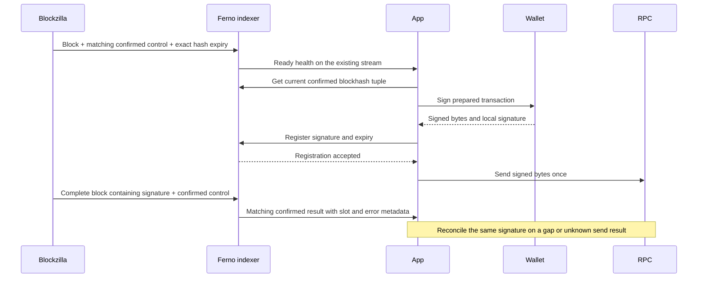

# Blockzilla confirmed stream: build specification

Status: proposed contract, 10 October 2026. Build the provider changes in
`blockzilla-v1`. This document does not state that this transport is installed.
The Ferno app changes described below are local changes and are not deployed.

## Required result

Ferno needs one server connection that supplies complete blocks and their actual
Agave confirmation state. It must provide a recent confirmed blockhash before
signing. After one send, a matching signature with successful execution in a
confirmed bank can complete the app action. Finalized history keeps its separate
commit path.

The provider must supply these items:

| Item | Required use |
| --- | --- |
| Complete compact block, signatures, execution results, and loaded addresses | Find the submitted signature; invalidate account reads affected by writes |
| Confirmed bank control with exact payload identity | Promote that bank's transaction results to confirmed |
| Confirmed head: slot, block height, blockhash, exact last valid block height | Prepare a transaction without a new blockhash RPC call |
| Source identity, freshness, cursor, and replay range | Detect the wrong network, a stopped source, and a gap |
| Root and invalidation controls | Keep finalized history separate and remove invalid bank observations |

A declared writable account is an invalidation hint. It is not replacement
account data. Complete account bytes are an optional second phase.

## Existing source and change points

The inspected working copy is `/Users/augustin/Developement/ferno/blockzilla-v1`,
base commit `454ed418`, with local processed stream changes. Record the final
provider commit and artifact identity when this contract is implemented.

| Provider file | Required change |
| --- | --- |
| `hivezilla/direct-agave/src/plugin.rs` | Capture actual bank confirmation and exact blockhash validity data from the pinned Agave bank |
| `hivezilla/direct-agave/src/event.rs` | Version the new callback record; keep bank identity and confirmation evidence |
| `hivezilla/direct-agave/src/processed.rs` | Persist confirmed state and emit a small control only after the complete bank payload commits |
| `hivezilla/direct-agave/src/journal.rs` | Preserve callback order, source sequence, durable publication, and visible overflow failure |
| `hivezilla/stream-relay/src/frame.rs` | Add explicit v2 profile admission and strict control validation |
| `hivezilla/stream-relay/src/source.rs` and `hivezilla/stream-relay/src/server.rs` | Add v2 source admission and routes |
| `hivezilla/stream-relay/src/upstream.rs` and `hivezilla/stream-relay/src/store.rs` | Add intake, durable replay, dependency retention, and head state |
| `hivezilla/stream-relay/src/main.rs` | Add profile and configuration wiring |
| `hivezilla/stream-relay/decoder/src/lib.rs` and `hivezilla/stream-relay/decoder/src/tests.rs` | Decode v2 controls, preserve signature/error coverage, and expose confirmed head data |
| `hivezilla/stream-relay/client/` and `hivezilla/stream-relay/examples/rust-consumer/src/main.rs` | Demonstrate reconnect, payload matching, confirmation, and an explicit gap |

Check the provider task instructions before its build. Its current relay guide
requires its builds on the remote machine. Do not alter the current v1 profile
or the Ferno vendored finalized schema to accept a new control without versioning.

## Transport and version

Use a separate profile, `native-bank-compact-v2`, and envelope schema
`blockzilla-stream-envelope-v2`. The v1 processed and finalized routes continue
to use their current contracts. The following routes are proposed new routes:

| Private GET route | Response |
| --- | --- |
| `/v2/banks/head` | Head JSON specified below |
| `/v2/banks/events?after=CURSOR` | SSE notices for every committed bank event, plus health and gap events |
| `/v2/banks/chunks/SHA256` | One finite immutable frame |

Use the current `BZSTRM01` frame layout: 8-byte magic, two little-endian u32
lengths, JSON envelope, then compact objects. Retain the 64 KiB metadata and
16 MiB binary payload limits. A control has zero objects and zero binary payload.
The frame digest covers all frame bytes. Reject an unsupported schema or profile.

The envelope retains the fields `schema`, `profile`, `evidence_included`,
`marker`, `objects`, and `event`. All are required in v2, and unknown fields are
rejected. `evidence_included` remains `false`; `event` uses the event schema below.
Keep the current compact object names, contiguous offsets, object digests, and
complete-block checks. Each `block` contains exactly one bank. Its original
processed compact marker remains unchanged. Verify the original marker digest
against `event.payload_sha256` at the origin, from the original marker file bytes,
before constructing the frame. That file is not a compact frame object. The
consumer verifies the full frame SHA-256 and requires the same
`payload_sha256` in the block and its controls. It must not hash re-serialized
embedded marker JSON and treat that value as the original file digest.

For a control, `marker` has schema `hivezilla-bank-control-v2`,
`state="COMPLETE"`, `source_profile="agave-bank-callbacks-v1"`, and the four
source identity fields listed below. It also has `canonical=false`,
`publication_ready=false`, `commitment` and `confirmation_basis` equal to the
event, and `finalized=true` only for a root. Reject other fields; in particular,
do not include `produced_blocks` or `files`. Its `objects` array is empty.

### SSE notices and response boundaries

Successful event responses use `Content-Type: text/event-stream; charset=utf-8`
and `Cache-Control: no-store`. They must return `X-Blockzilla-Start-Cursor` with
the exact accepted boundary before the body starts. Add this header to the SSE
route; the current v1 SSE handler does not supply it. Send an initial `status`
event immediately, then status updates at least every 5 seconds.

Use these event shapes:

| SSE event | ID and data |
| --- | --- |
| `chunk` | `id` is the exact event cursor. Data contains `cursor`, `sha256`, `bytes`, `start_slot`, `end_slot`, and `url` |
| `status` | No ID. Data is the complete head shape below; it does not advance the replay cursor |
| `gap` | No ID. Data contains `error` and the current `head`; close the response after delivery |

A chunk URL is the relative path `/v2/banks/chunks/SHA256` for its frame digest.
`bytes` is the exact finite frame length. Slot bounds are inclusive and both
equal the bank slot for this one-bank profile, including controls. Older-slot
controls are valid; the event sequence determines replay order. Verify notice
ID, notice cursor, source session, frame sequence, frame digest, byte length,
and slot bounds before applying it. Do not follow an arbitrary notice URL.

Use bounded gap error codes: `source_changed`, `replay_unavailable`,
`source_failed`, or `dependency_unavailable`. Before response headers, return
HTTP 410 with the same error/head shape for an unavailable replay boundary or
a changed source. Invalid cursors and conflicting cursor inputs return HTTP
400 with `invalid_cursor` or `cursor_conflict`. Never reset the cursor silently.

Use HTTPS and a backend `Authorization: Bearer` header. Keep keys out of browser
settings, URLs, notice URLs, and logs. Use the existing mTLS rules for the origin.
Do not follow a redirect to a different source. Retain bounded clients, body
sizes, and spool storage. No transaction filter may omit a block from this feed.

## Bank events

Retain the current `BankIdentity` fields: `slot`, `bank_id`, `blockhash`,
`parent_slot`, and `parent_blockhash`. Hash fields in this native identity remain
32-byte arrays. A bank ID is scoped to the node and source session.

The v2 event has the following fields. JSON names are deliberate; keep these
names in fixtures and decoder output. The schema is in
[the contract schema](contracts/blockzilla-bank-stream-v2.schema.json).
The [synthetic examples](contracts/blockzilla-bank-stream-v2.examples.json) show
the control and head shapes. They are not encoded provider evidence.

| Field | Rule |
| --- | --- |
| `sequence` | Consecutive published event number, starting at 1 |
| `source_sequence` | Exact captured callback sequence; it is not a slot number |
| `kind` | `block`, `confirmed`, `root`, or `invalidate` |
| `bank` | Complete existing bank identity |
| `payload_sha256` | SHA-256 of the original compact commit marker bytes, as in v1; never the frame digest |
| `payload_frame_sha256` | Digest of the immutable full `block` frame for controls; `null` for the `block` frame itself |
| `commitment` | `processed` for `block`, `confirmed` for `confirmed`, `finalized` for `root`, `null` for `invalidate` |
| `confirmation_basis` | Explicit operator-trusted callback basis; `null` for invalidation |
| `block_height` | Actual bank block height for block/confirmed/root; `null` only for invalidation |
| `recent_blockhash` | Hash and exact validity data for confirmed/root; `null` for block/invalidate |
| `observed_at_unix_ms` | Source observation time; do not replace it with relay delivery time |
| `reason` | `null`, or a bounded invalidation reason |

`recent_blockhash` contains canonical base58 `blockhash`, `context_slot`, and
`last_valid_block_height`. Its context must equal `bank.slot`; the decoded hash
must equal `bank.blockhash`. Read the exact last valid height for that hash from
the same bank's blockhash queue. If the pinned callback does not expose that
value, add a bank-aware Agave hook. Do not calculate it from a slot plus 150.
Solana returns a blockhash and its exact expiry together in
[getLatestBlockhash](https://solana.com/docs/rpc/http/getlatestblockhash).
The pinned Agave implementation uses `bank.last_blockhash()` and
`bank.get_blockhash_last_valid_block_height(&hash)` in
[its RPC implementation](https://github.com/anza-xyz/agave/blob/825efd18292aff6ffcf9daa0f7612f21b3531a72/rpc/src/rpc.rs).

The new control marker uses schema `hivezilla-bank-control-v2`. It carries the
same source identity as its full payload. Keep `canonical=false` and
`publication_ready=false`: this is an operator-trusted feed. A processed payload
marker remains processed after confirmation. A control carries the later state;
it does not rewrite the original payload or its digest.

All public counters must be integers from 0 through 9007199254740991. Sequences
and expiry heights must be positive. Parent slots must be less than child slots.
Verify canonical base58 and the fixed hash length in code; a JSON string pattern
alone does not prove the decoded length.

### Confirmation evidence and publication

Use actual Agave confirmation evidence. `Processed`, a frozen bank, a block
callback, and elapsed time cannot establish confirmed commitment. Use the pinned
bank-aware `SlotStatus::Confirmed` callback if it carries the complete bank
identity. If it only supplies a slot, bind it to the exact confirmed bank through
an Agave hook. Do not select the last bank seen at that slot.
The current plugin already records `status="confirmed"` in its bank-aware
callback. The event index maps it to a generic status, and the processed
publisher does not keep a `confirmed_sequence`. Add that persistent state before
construction so a callback/build race or restart cannot lose confirmation.
Add the exact blockhash tuple at the confirmed bank boundary in the pinned
[optimistic confirmation tracker](https://github.com/anza-xyz/agave/blob/825efd18292aff6ffcf9daa0f7612f21b3531a72/rpc/src/optimistically_confirmed_bank_tracker.rs).
Capture and persist this native queue tuple for every complete bank that can
be confirmed or rooted. Capture it once at the frozen bank boundary, or invoke
the hook for both confirmed and rooted callbacks. A root without stored native
expiry data cannot supply a hash. Do not invent its expiry.

Callbacks can arrive before transactions, entries, or the footer complete. Hold
the control until the existing complete-bank check passes and the immutable
payload plus publication record commit. Retain a bounded pending set. Overflow,
missing data, or a contradictory bank identity makes the source unhealthy; it
does not authorize a partial success record.

Emit a full `block` once, then a `confirmed` control, then a `root` control if
that bank becomes rooted. Conversion and full block delivery occur once. A
`root` can also be the first evidence of stronger commitment if confirmation was
not observed; retain its truthful `finalized` label. Duplicate callbacks are
idempotent and do not emit another full block.

If Agave confirms a tip and the producer derives confirmation of its ancestors,
walk the exact captured parent chain and emit a control for each complete bank
on that chain. Keep the originating callback sequence and evidence basis. Do
not confirm every bank whose slot is less than the tip. Competing banks at one
slot are separate. If a required parent cannot be resolved, report a gap.

On invalidation, remove that bank and its affected descendants from current
views. If the provider invalidates a bank it already reported as confirmed,
emit the control, clear readiness, and require reconciliation. A rooted bank
invalidation is a source failure. Do not silently hide either condition.

## Head, health, and readiness

Head schema: `blockzilla-confirmed-head-v1`. Include `profile`, `source`, `cursor`,
`earliest_after`, `status`, `sampled_at_unix_ms`, `source_observed_at_unix_ms`, `source_lag_ms`, and
`latest_confirmed`.
`source` includes the trusted `genesis_hash`, `node_identity`, `agave_revision`,
and `session_id`. `latest_confirmed` is `null` until available; otherwise it
contains the bank identity, actual block height, complete payload marker digest,
payload frame digest, recent blockhash tuple, and source observation time.
It also identifies its `confirmed` or `finalized` commitment, originating
`event_sequence`, and exact `event_cursor`. Publish this observation and head
cursor in one atomic snapshot. Its event must be committed at or before the
head cursor in the same source session and profile.

Track the bank with the highest trusted height on the current admitted
confirmed/rooted chain. A late root or ancestor control for an older bank must
not replace the usable hash or renew its observation age. Clear the selected
bank if an invalidation affects it or its ancestry. An unresolved chain cannot
supply a hash. Test that an older root never replaces a newer confirmed head.

Use `status` values `starting`, `live`, `stale`, or `failed`. `live` requires an
actual complete confirmed observation and healthy capture, publication, and
relay stages. An open socket or a relay timer cannot set `live`.

SSE `status` events send this same health shape at least every 5 seconds. They
retain the source observation time. A heartbeat from a stopped capture must show
`stale` or `failed`.

`sampled_at_unix_ms` is the relay time when it takes the atomic head snapshot.
`source_observed_at_unix_ms` equals the selected `latest_confirmed` observation
time. `source_lag_ms` is the non-negative difference between these two times.
It measures confirmed observation age at the relay, not a slot difference.
It is `null` when no confirmed observation exists. A heartbeat changes sample
time and lag, but cannot change the selected source observation time.

Require synchronized source, relay, and receiver clocks. At admission, reject
any sample or observation timestamp more than 5 seconds ahead of receiver time.
The relay applies the same limit to source timestamps before it calculates lag.
Only then may a small negative age within that clock allowance become zero.
Use a proposed default maximum source lag of 5000 ms, and expose the measured
value. A higher lag changes status to `stale`.

The Ferno receiver also requires the selected confirmation age below 15 seconds.
Use a monotonic timer to add elapsed time after admission and remove readiness
within 15 seconds without a valid update. A wall clock change cannot extend an
admitted observation's life. Repeated health for the same old observation cannot
reset its age. Apply both source lag and receiver age limits before using a hash.

Ferno marks its transaction transport ready after source admission, an accepted
start boundary, receipt of current health, and resolution of all required
payloads through its current cursor. It must retain pending signature listeners
before send. Dashboard SQL preparation cannot delay this transport.

## Replay and payload retention

Use `SESSION:pEVENT_SEQUENCE:FRAME_SHA256` cursors in the new route namespace.
The sequence advances for every kind, including controls for older slots. Slot
order is not event order. Bind a saved cursor to profile and full source identity.

An absent `after` is an explicit fresh start at connection open. Return the exact
accepted boundary before delivery. An exact cursor resumes after that event.
Conflicting `Last-Event-ID` and query cursors return 400. A source/session change
or expired cursor returns 410 with current head information; never jump to head
as an implicit repair.

Every retained control must retain its referenced full payload or make that
payload available through `payload_frame_sha256`. A client that starts after
the earlier `block` event can fetch the dependency before it promotes a result.
Payload and control retention must be atomic. An unavailable dependency is a
gap. It is not an empty block. Missing metadata is not an execution success.

Publish only after fsync and the spool checkpoint commit. Client acknowledgement
occurs after it applies the event and saves its cursor. Replay of an acknowledged
frame is idempotent. Confirmed observations use a separate checkpoint from
Ferno's finalized SQLite history. Do not delete captured source evidence because
a live consumer acknowledged a frame.

Configure finite byte budgets and expose the earliest retained boundary. Target
at least 10 minutes of replay at the measured production rate; report achieved
duration and bytes. When a budget expires a slow client, send an explicit `gap`
and close it. A finite replay window never proves that all older history exists.

## Ferno consumer and transaction flow

Add a separate confirmed provider adapter after the provider fixtures pass. Its
configuration must be opt-in. Keep the existing finalized history adapter and
its source/checkpoint checks. No processed block enters finalized SQL history.

The adapter stores complete banks in a bounded cache keyed by full source,
bank identity, and payload digest. A control only promotes its exact payload.
Decode all transaction signatures and actual execution outcomes; failed
transactions are included. Expose `source=blockzilla` and truthful commitment to
Ferno's existing `TransactionWatches` and `transaction-feed` health.

Retain the newest healthy confirmed hash tuple for the blockhash endpoint.
Validate its age, bank identity, and caller slot floor on every read. Fall back
to one authenticated confirmed RPC lookup when the stream is unavailable. Pass
the selected context slot as `minContextSlot` for send; do not change the message
or blockhash after wallet signing. Jupiter-built transactions must keep their
own exact matching hash and expiry.

A successful transaction result requires the exact local signature, matching
wallet watch, confirmed or finalized commitment, a safe slot, and explicit
successful execution metadata. Receipt of a processed block does not complete
the action. A lost send response cannot cause another send. A valid confirmation
can finish the UI while the original send response is still pending.

When confirmed block height exceeds the signed hash's `last_valid_block_height`,
perform one final history-enabled signature check. An absent result can expire
only with a status context at least as recent as that height observation. A
processed signature can still confirm; a gap or failed check leaves the result
unknown. Solana distinguishes expiry heights from slot counts in its
[confirmation guide](https://solana.com/developers/cookbook/transactions/confirmation).
The RPC fallback obtains height and slot together with
[getEpochInfo](https://solana.com/docs/rpc/http/getepochinfo).

For account invalidation, combine static and loaded writable addresses and fee
payer effects, including failed transactions. Batch each affected tracked
account once; require a confirmed RPC account context at or above its latest
known write slot. Invalidate old cached bytes before publishing new data. Keep
unknown data unavailable when a stream gap prevents a valid freshness check.

## Optional second phase: complete account updates

To remove those hydration RPC calls, add bank-bound post-execution account
updates: address, owner, lamports, executable, rent epoch, complete data bytes,
bank identity, slot, and write version. Include deletion/tombstone records and
all accounts changed by execution, fees, and system effects. Do not derive final
bytes from declared writable flags or transfer balances alone.

Apply updates atomically with their bank observation. Promote them only with
matched confirmed evidence. Define invalidation/undo and restart snapshot rules
before serving them as planning data. This extension is separate from the
minimum confirmed transaction stream above.

## Acceptance and handoff

The provider build must include real encoded frames, decoded expected results,
source identity, exact cursors, and a recorded test command for these cases:

1. Processed block alone does not confirm a signature or supply a confirmed hash.
2. Confirmed control promotes only its exact complete bank and digest.
3. Same-slot competing banks and ancestor confirmation use exact parent links.
4. Confirmation before the footer waits for complete data; missing data fails.
5. Failed execution retains a non-null error and never reports success.
6. Skipped slots do not change the bank's actual expiry calculation.
7. Wrong genesis, session, node, Agave revision, digest, profile, or cursor fails.
8. Reconnect replays every kind once; duplicate application is idempotent.
9. Restart retains controls and required payloads; eviction returns an explicit gap.
10. Source stop cannot keep readiness alive through relay heartbeats.
11. Invalidations remove the affected bank; rooted invalidation fails the source.
12. Queue overflow, oversized frames, and slow clients remain bounded and visible.
13. A late older root cannot renew or replace the confirmed head's usable hash.
14. A root without prior confirmation uses its stored native queue tuple;
    missing native expiry makes the hash unavailable.
15. Future timestamps, excessive source lag, repeated old health, and local
    wall clock changes cannot make an old confirmed hash ready.
16. SSE start boundaries, notice IDs, frame digests, dependency reads, and
    HTTP/SSE gap responses follow the exact contract above.

Also build and load the actual plugin on the required remote machine with the
exact patched Agave host. Record the host commit, plugin commit, plugin artifact
digest, and load result. An isolated native callback test must demonstrate
confirmed bank identity and the real blockhash queue expiry tuple. Synthetic
JSON or decoder fixtures do not prove plugin ABI compatibility or native hooks.

Ferno acceptance adds: listener and registration before one send, successful
confirmation with a stalled send response, lost response reconciliation, strict
wallet/signature/expiry binding, expired hash during wallet approval, processed
status beyond hash expiry, lagging status context, and no RPC recovery work when
there are no pending watches.

Record callback-to-control, control-to-app, click-to-wallet, and send-to-confirm
p50/p95 times on the intended route. A proposed target is under 250 ms p95 from
confirmation callback to app notification, excluding network confirmation time.
This is an acceptance target, not a measured result. Record sustained throughput,
apply lag, resource use, replay duration, and the provider/consumer build commits.

The local Ferno candidate now has immediate stream headers, independent feed
health, registration before one send, exact RPC blockhash expiry, and bounded
signature reconciliation. It does not yet ingest this proposed v2 provider
contract. Implement and validate the Blockzilla fixtures first, then enable the
consumer adapter and run the feed soak test.
